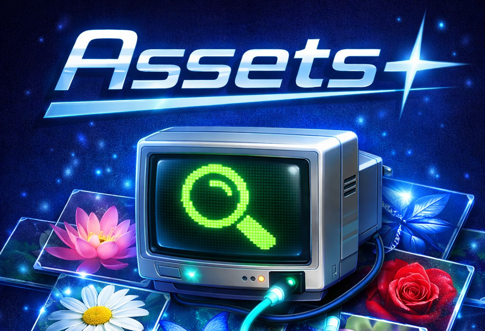

# ComfyUI-AssetsPlus 
<p align="center">
  
</p>

Assets+ is an extension for ComfyUI that adds the **Assets+ Explorer** sidebar panel and provides a
persistent overview of the output and input directories via the `/assets_plus` API.

## Disclaimer about AI usage
* The project was started with AI help: the base of this extension was written almost purely by OpenAI Codex, and some work was done with [DeepSeek V4 Flash Free](https://openrouter.ai/deepseek/deepseek-v4-flash:free) through the [OpenCode](https://github.com/anomalyco/opencode) and [OhMyOpenagent](https://github.com/code-yeongyu/oh-my-openagent) environments.
* Today the project is fully maintained with [Anthropic Claude](https://www.anthropic.com/claude).
* Please report any quirks or mishaps at Issues page.
* Any PRs will be greatly appreciated, thank you!

## Installation

1. Clone the repository into ComfyUI’s `custom_nodes/` (you should end up with
   the folder `custom_nodes/ComfyUI-AssetsPlus/`).
2. Restart ComfyUI.
3. (Optional) `send2trash` (`pip install send2trash`) is used for the trash bin when installed;
   without it the extension uses its own native trash support (Windows, Linux, macOS).

The frontend consists of 8 ES-modules in `custom_nodes/ComfyUI-AssetsPlus/web/` and is
loaded automatically by ComfyUI.

## How to open Assets+ Explorer

1. Open the ComfyUI sidebar.
2. Click the **Assets+ Explorer** tab (folder icon).

If the panel doesn’t show up:
- check that the folder is named `custom_nodes/ComfyUI-AssetsPlus/`;
- make sure ComfyUI was restarted after installation.

## Settings

The config file is located at `user/__assets_plus/config.json`. If the file doesn’t exist,
defaults are used.

Available options:
- `allowed_extensions`: a list of extensions (e.g. `[".png", ".jpg", ".webp"]`).
- `thumbnail_quality`: `"low"` (256px) or `"high"` (512px).
- `list_limit`: page size for list requests.
- `recursive`: recursive scan of the output directory (`true/false`).
- `default_delete_mode`: `"trash" | "delete" | "hide"`.
- `scan_depth`: depth limit for recursive scanning (`null` = no limit).
- `log_level`: how much Assets+ writes to the console, `"silent" | "quiet" | "info" | "debug"` (default `"quiet"`, also a setting, see below).

UI settings (ComfyUI Settings → Assets+ Explorer):
- **Assets+ page size** — number of items fetched per page.
- **Assets+ confirm deletions** — toggle confirmation dialogs for delete/hide actions.
- **Assets+ always confirm deleting starred images** — ask for confirmation when starred items are deleted, even if general confirmations are off.
- **Assets+ show starred first** — list starred items at the top of the gallery.
- **Assets+ show overlay navigation hint** — toggle the on-screen navigation hint in the lens overlay.
- **Assets+ keep overlay open when opening/replacing workflow** — keep the lens overlay open after workflow actions.
- **Assets+ thumbnail quality** — pick low (256px) or high (512px) previews.
- **Assets+ clear thumbnail cache** — action button to remove cached previews on disk.
- **Assets+ console log level** — Silent (errors only), Quiet (default: start-up banner, warnings), Info (also deletes, moves, stars, cache housekeeping), Debug (every request). It is stored in `config.json` on the server.

Example:
```json
{
  "allowed_extensions": [
    ".png", ".jpg", ".jpeg", ".webp", ".gif", ".bmp", ".tiff",
    ".mp4", ".webm", ".mov", ".mkv",
    ".mp3", ".flac", ".wav", ".ogg", ".m4a",
    ".glb", ".gltf"
  ],
  "thumbnail_quality": "low",
  "list_limit": 200,
  "recursive": true,
  "default_delete_mode": "trash",
  "scan_depth": null
}
````

## Features

* List assets from the output and input directories (recursively).
* Thumbnails via `/assets_plus/output/thumb` and `/assets_plus/input/thumb`.
* Workflow/prompt metadata (from images and videos) via `/assets_plus/output/meta` and `/assets_plus/input/meta`.
* Deleting from disk (trash/delete) or hiding (hide) with confirmation in both tabs.
* Full-screen lens overlay with navigation, workflow actions, zoom/pan controls, Esc-to-close, image format/size/zoom badges, and quick print/copy actions for images.
* Assets+ shortcuts tab in the ComfyUI Shortcuts panel for overlay navigation actions.
* Move generated results into the Imported tab (the ComfyUI input folder) with the `E` hotkey in the lens, the button in the lens, or in selection mode for many files at once. They stop being results and become assets for your generations, which also keeps them out of the way of mass clean-ups of the output folder. Files land in the root of the input folder (so Load Image can see them); name clashes get a `_1`, `_2`... suffix and nothing is overwritten. Stars move along with the file.
* Selection mode (toggle in the header): tiles lose the workflow menu and drag-and-drop, and the star becomes a read-only indicator, and a click selects a tile (green overlay with a check mark) instead of opening the lens. Shift+click selects (or deselects) the whole range from the previously clicked tile. Select all / invert selection live there too. With something selected, the header offers delete (the usual silent-delete and "always confirm starred" rules apply), star/unstar (toggles: removes the stars when all selected are already starred), move to Imported (Generated tab only) and download.
* Star your favorites with the star button on a tile or in the lens, or with the `Q` hotkey in the lens. Stars are kept next to the hide list, so your files are never modified, and they follow files that are renamed or moved by hand.
* Sticky header with icon-based actions (search toggle, selection mode, select all, invert selection, star/move/download/delete of the selection) while only the gallery area scrolls.
* Server-side search optimized for large galleries.
* Lazy loading of thumbnails and paged scrolling for large galleries.
* Built for big folders: the server keeps a snapshot of the folder tree (revalidated by directory timestamps, rescanned when anything changes) and serves pages lazily from it, workflow detection only runs for the files on the page, and thumbnails are cached by the browser. The lens can jump to the oldest file or step past the loaded part of the gallery without loading everything in between. The refresh button forces a fresh scan.
* Event-driven updates when ComfyUI emits execution or upload events (no polling).
* Expanded media support from @svilendotorg: additional image/video formats, audio playback in the overlay, GLB/GLTF mesh previews, and arrow-key overlay navigation.

## Console output

Assets+ is quiet by default. At start-up it prints one line with the installed version and then only warnings and
errors:

```
Assets+ v1.1.2 · ready
```

It makes no network requests and reads nothing but its own `pyproject.toml` for that line; whether a newer version
exists is for ComfyUI-Manager to tell you.

## Deletion modes

* **trash** — moves files to the system trash bin: via `send2trash` when it is installed,
  otherwise natively (Recycle Bin on Windows, the freedesktop.org trash on Linux, `~/.Trash` on
  macOS). There is no fallback to permanent deletion in this mode: if a file cannot be trashed, it
  stays in place and an error is shown. (Volumes without a Recycle Bin, e.g. some network
  drives, are handled by the operating system and may delete immediately.)
* **delete** — permanently deletes the file.
* **hide** — hides the asset from the list while keeping the file on disk
  (the index is stored in `user/__assets_plus/hidden.json`). Entries for files that disappeared are
  cleaned up automatically, and entries follow a file that was renamed or moved by hand.

Starred items are stored the same way in `user/__assets_plus/starred.json`.

## Tile actions and workflow actions

Hovering a tile shows a small panel in its top-right corner: a download button and a **more** (⋯) button. The same menu opens with a right click on the tile (not in selection mode). It offers Inspect asset (the lens), Insert as node in workflow (a Load Image/Video/Audio node at the centre of the canvas), Download, the workflow actions below, Export workflow (saves the embedded workflow, or the prompt, as a `.json`), Star / Remove star, Move to Imported (Generated tab) and Delete (the usual silent-delete and starred-confirm rules apply).

If an asset has workflow metadata, the menu also exposes:

* **Open workflow (new tab)** — opens the workflow in a new tab (like standard Media Assets).
* **Replace current workflow** — replaces the workflow in the current tab without creating a new one.

These actions work for images (PNG/WebP) and for videos saved by ComfyUI's Save Video / Save WEBM nodes
(MP4, MOV, WebM, MKV carry the workflow as embedded metadata; the lens has the same two buttons).
The metadata is read from the file itself with a small built-in reader, no extra packages needed.

Files made through the API (for example batch or profiling runs) only carry the `prompt`, not the editor
workflow. For those the same actions rebuild a graph from the prompt with ComfyUI's own API-format loader and
tell you so: node positions are laid out automatically, groups and notes are not stored in a prompt.

If there is neither a workflow nor a prompt in the file (or ComfyUI ran with `--disable-metadata`), the menu is hidden.

## Limitations

* Asset sources are ComfyUI’s output/input directories only (no arbitrary paths).
* Videos are served as-is. `.mp4`/`.webm` can be previewed directly in tiles; `.mov`/`.mkv` use a placeholder tile and rely on browser playback support in the overlay.
* Search is executed by the backend (depends on `/assets_plus/*/list?query=`).
* Delete confirmations can be disabled in Settings (Assets+ confirm deletions).

## ComfyUI-Manager compatibility

The extension structure matches Manager requirements:

* `__init__.py` exports `WEB_DIRECTORY` so the frontend is picked up automatically.
* `web/main.js` registers the **Assets+ Explorer** tab via `registerSidebarTab`.
* No extra installation steps are needed besides restarting ComfyUI.

## Notes

* Trash support lives in `assets_plus/trash.py` (`send2trash` first, native implementation otherwise).
* Hidden assets are stored in `user/__assets_plus/hidden.json` (input entries are namespaced).
* Thumbnail cache: `user/__assets_plus/thumb_cache/`.
* The thumbnail cache can be cleared from settings or via `POST /assets_plus/thumb/clear`.

## Third-party assets

* `web/vendor/model-viewer.min.js` — [`@google/model-viewer`](https://github.com/google/model-viewer) v4.0.0 and its bundled upstream dependencies. License headers are preserved in the vendored file. It is bundled on purpose, so the extension stays self-contained and works offline; it is byte-identical to the upstream npm release (SHA-256 and verification steps in [VENDORED.md](VENDORED.md)). See [SECURITY.md](SECURITY.md) for what the extension can and cannot do.
